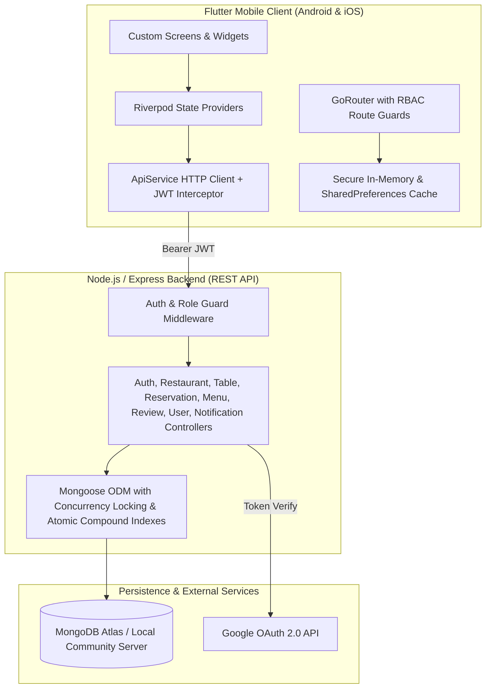

# TableTurn — Full-Stack Restaurant Discovery & Smart Reservation Platform

TableTurn is a secure, multi-tenant restaurant discovery and table reservation mobile application built with **Flutter (Riverpod + GoRouter)** and backed by a **Node.js, Express, and MongoDB** microservices architecture. It features genuine authentication, Google OAuth 2.0 ID token verification, strict role-based access control (Customer, Restaurant Manager, Administrator), atomic double-booking prevention, cryptographic digital QR dining passes, and nationwide venue discovery across Bangladesh.

---

## 🏛️ System Architecture



---

## 👥 Three Separate User Roles & Security Matrix

| Role | Access Level | Primary Capabilities | Guard Enforcement |
| :--- | :--- | :--- | :--- |
| **Customer** | Client Consumer | Browse restaurants, live search & division filter, view categorized menus and reviews, select available dining tables, book reservations, view QR passes, cancel reservations, manage favorites & notifications. | Cannot access `/manager*` or `/admin*`. Scoped to own reservations & favorites. |
| **Manager** | Venue Host | Access Manager Dashboard, manage assigned restaurant only (`managedRestaurantId`), cycle table availability, view incoming bookings, update booking status, scan and verify customer QR passes. | Authoritative tenant isolation: 403 Forbidden on foreign restaurant tables, bookings, or QR passes. |
| **Admin** | Platform Operator | Global oversight, manage all registered customers & managers, inspect all nationwide partner restaurants, audit platform reservations, view system telemetry. | Enforced by backend allowlist (`ADMIN_EMAIL`) and signed JWT role claims. Cannot be self-assigned. |

---

## 🚀 Getting Started

### 1. Prerequisites
- **Flutter SDK**: 3.24+ (Dart 3.5+)
- **Node.js**: v18.0.0 or higher
- **MongoDB**: Local MongoDB Community Server running on `127.0.0.1:27017` OR a MongoDB Atlas cluster URI.

---

### 2. Backend Setup

1. Open a terminal and navigate to the `backend/` directory:
   ```bash
   cd backend
   ```

2. Install dependencies:
   ```bash
   npm install
   ```

3. Configure your environment variables:
   Copy `.env.example` to `.env`:
   ```bash
   cp .env.example .env
   ```
   *Default development values in `.env`:*
   ```env
   PORT=5000
   NODE_ENV=development
   MONGO_URI=mongodb://127.0.0.1:27017/tableturn
   JWT_SECRET=super_secret_tableturn_production_jwt_key_2026_xyz
   ADMIN_EMAIL=admin@tableturn.app
   GOOGLE_CLIENT_ID=your-google-oauth-client-id.apps.googleusercontent.com
   ```

4. Seed the database with nationwide venues, tables, menus, and users:
   ```bash
   npm run seed
   ```

5. Start the backend API server:
   ```bash
   npm run dev
   # Or standard start:
   npm start
   ```
   The backend will start on `http://localhost:5000` (or `http://10.0.2.2:5000` when accessed from the Android Emulator).

---

### 3. Pre-Seeded Accounts for Immediate Testing

| Role | Email Address | Password | Details |
| :--- | :--- | :--- | :--- |
| **System Admin** | `admin@tableturn.app` | `adminpassword123` | Authoritative platform administrator. |
| **Restaurant Manager** | `manager@theforestlounge.com` | `managerpassword123` | Assigned to *The Forest Lounge* (Banani/Gulshan-2, Dhaka). |
| **Customer** | `raiyan@tableturn.app` | `customerpassword123` | Regular customer with active booking history. |
| **Guest Customer** | `tasmia@tableturn.app` | `dinerpassword123` | Secondary diner account. |

---

### 4. Running the Flutter Application

1. In the project root directory, install Flutter packages:
   ```bash
   flutter pub get
   ```

2. Run code analysis:
   ```bash
   flutter analyze
   # Output: No issues found!
   ```

3. Run full automated tests:
   ```bash
   flutter test
   # Output: All 23 tests passed!
   ```

4. Run the app on your preferred emulator or device:
   ```bash
   # Android
   flutter run -d android

   # iOS
   flutter run -d ios

   # Chrome Web
   flutter run -d chrome
   ```

> **Note on Android Emulator Network:**
> `ApiService.baseUrl` automatically uses `http://10.0.2.2:5000/api` when running inside an Android emulator to cleanly bridge to the host machine's `localhost:5000`. On iOS Simulator or desktop/web, it routes to `http://localhost:5000/api`.

---

## 🔒 Security Architecture Highlights

1. **Zero-Trust Role-Based Access Control (RBAC):**
   - User roles are never trusted from the client.
   - During registration, all self-signups are assigned `customer`.
   - Admin status is verified via authoritative `ADMIN_EMAIL` allowlist and secured database record.
   - GoRouter blocks unauthorized route entry, redirecting guests to `/sign-in` and customers attempting staff routes to `/home`.

2. **Atomic Double-Booking Prevention:**
   - Both backend and Flutter client check for overlapping reservations for the same table, time slot, and date.
   - Backend performs atomic validation before creating a reservation, returning `409 Conflict` if the table is already booked.
   - A MongoDB compound index on `(restaurantId, tableId, timeSlot, reservationDate)` guarantees query speed and conflict prevention.

3. **Verifiable Digital QR Dining Passes:**
   - Every confirmed reservation generates a tamper-evident signature:
     `TT-2026-XXXXXX:REST_ID:TABLE_ID:USER_ID:TIMESTAMP`.
   - Managers scanning QR passes are scoped strictly to their assigned restaurant. Attempting to scan a reservation from a different restaurant returns `403 Forbidden` and displays a security alert in the host UI.

4. **Genuine Google OAuth 2.0:**
   - Client retrieves genuine Google ID token via `google_sign_in`.
   - Backend cryptographically verifies the token signature with Google's public keys via `google-auth-library`.

---

## 🧪 Testing Suite & Verification

- **Backend Integration Tests:**
  ```bash
  npm test
  # Runs backend/test/backend.test.js covering 12 test suites:
  # Health check, venue retrieval, table filtering, auth, booking creation,
  # double-booking rejection (409), manager QR verification, tenant isolation (403),
  # cancellation, admin oversight, and menu/review aggregation.
  ```

- **Frontend Flutter Tests:**
  ```bash
  flutter test
  # Runs all 23 unit, widget, and provider integration tests:
  # - interaction_test.dart (Splash -> SignIn -> OTP -> Success flow)
  # - milestone_1_features_test.dart (draft creation, status transitions, table availability)
  # - security_and_phase1_test.dart (double-booking rejection, dynamic user injection)
  # - phase5_phase7_integration_test.dart (restaurant filtering, favorites sync,
  #   online booking, tenant-scoped QR scanning, notification read status, table cycling)
  ```

---

## 📱 Android Release Build Preparation

1. The Android configuration in `android/app/build.gradle.kts` is configured for Java 17 and Kotlin 2.1.
2. Network permissions and cleartext HTTP traffic for local development are configured in `android/app/src/main/AndroidManifest.xml`.
3. To generate a release APK:
   ```bash
   flutter build apk --release
   ```
